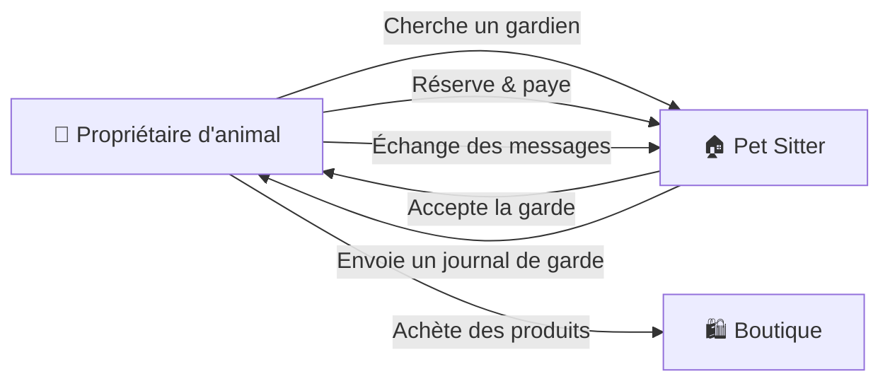
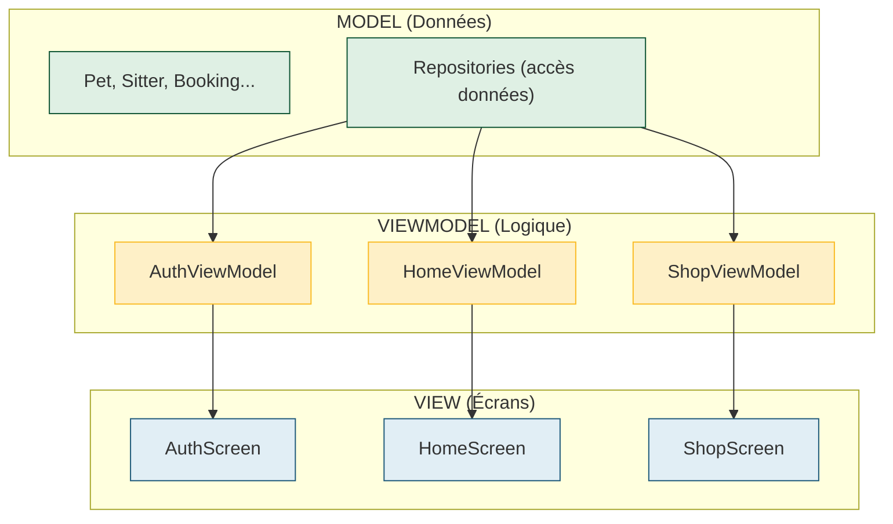
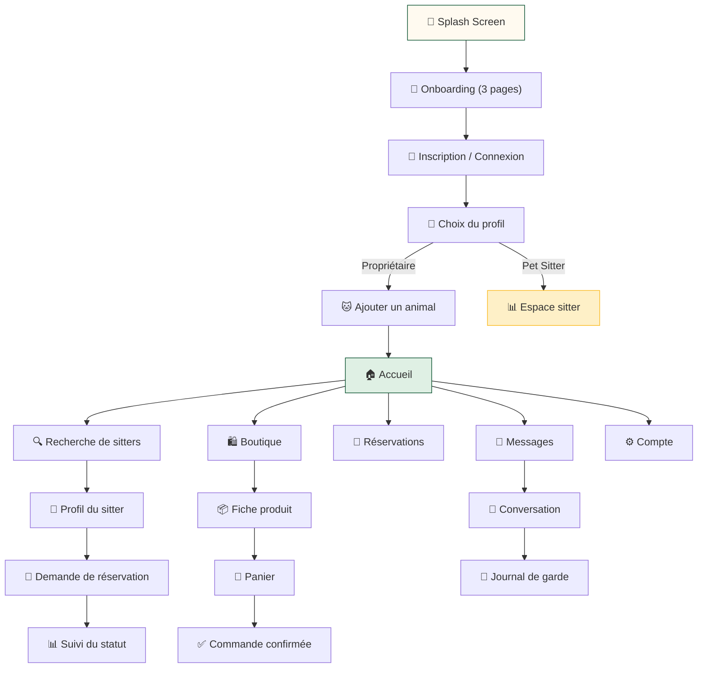

# 🐾 Explication complète du projet **Lamma Pets** (Pet Sitter)

## Table des matières
1. [C'est quoi Flutter ?](#cest-quoi-flutter)
2. [Le concept de l'application](#le-concept-de-lapplication)
3. [Structure du projet](#structure-du-projet)
4. [Architecture MVVM](#architecture-mvvm)
5. [Explication fichier par fichier](#explication-fichier-par-fichier)
6. [Les concepts Flutter clés dans ce projet](#les-concepts-flutter-clés)
7. [Flux utilisateur (parcours dans l'app)](#flux-utilisateur)
8. [Résumé visuel](#résumé-visuel)

---

## C'est quoi Flutter ?

> [!IMPORTANT]
> **Flutter** est un framework open-source créé par **Google** pour développer des applications **mobiles** (Android + iOS), **web** et **desktop** à partir d'un **seul code source**.

### Les bases de Flutter en 5 points :

| Concept | Explication |
|---------|-------------|
| **Langage** | Flutter utilise **Dart**, un langage de programmation créé par Google, similaire à Java/JavaScript |
| **Widget** | Tout dans Flutter est un **widget** (un composant visuel) : un bouton, un texte, une image, une page entière |
| **Hot Reload** | Tu modifies le code → l'app se met à jour en **temps réel** sans redémarrer |
| **Cross-platform** | Un seul code = une app qui tourne sur Android, iOS, Web, Windows, Mac, Linux |
| **Material Design** | Flutter intègre les composants de design de Google (boutons, menus, barres de navigation…) |

### Comment fonctionne un Widget Flutter ?

```dart
// Un widget est une CLASSE qui décrit un morceau d'interface
class MonBouton extends StatelessWidget {
  @override
  Widget build(BuildContext context) {
    // build() décrit CE QUI S'AFFICHE à l'écran
    return ElevatedButton(
      onPressed: () => print('Cliqué !'),
      child: Text('Appuyez ici'),
    );
  }
}
```

Il y a **2 types de widgets** :
- **`StatelessWidget`** → ne change **jamais** (texte fixe, icône…)
- **`StatefulWidget`** → peut **changer** (compteur, formulaire, toggle…)

---

## Le concept de l'application

**Lamma Pets** (لمّة Pets) est une application de **garde d'animaux entre voisins en Tunisie** 🇹🇳.

### Qui utilise l'app ?



### Les fonctionnalités principales :

| Module | Description |
|--------|-------------|
| 🔐 **Authentification** | Inscription, connexion, mot de passe oublié, choix du profil |
| 🏠 **Accueil** | Recherche de pet sitters par quartier, type de service, espèce d'animal |
| 🔍 **Recherche** | Résultats en liste ou sur carte, filtres |
| 👤 **Profil sitter** | Bio, avis, services, tarifs, photos |
| 🐱 **Mes animaux** | Ajouter un animal (chat, chien, oiseau, lapin, poisson…) |
| 📅 **Réservation** | Demander une garde, voir le devis, suivre le statut |
| 💬 **Messagerie** | Chat entre propriétaire et sitter + journal de garde |
| 🛍️ **Boutique** | Nourriture, accessoires, jouets, hygiène — avec panier |
| 👨‍💼 **Espace sitter** | Tableau de bord, disponibilités, services et tarifs |

---

## Structure du projet

```
lamma_pets/
├── lib/                          ← 🎯 TOUT LE CODE DART EST ICI
│   ├── main.dart                 ← Point d'entrée de l'app
│   ├── app/
│   │   ├── app.dart              ← Configuration de l'app (thème, langue, routes)
│   │   ├── dependencies.dart     ← Injection de dépendances
│   │   └── routes.dart           ← Toutes les routes/pages de l'app
│   ├── core/
│   │   ├── theme/
│   │   │   ├── app_theme.dart    ← Couleurs, typographie, style des composants
│   │   │   └── ph_icons.dart     ← Icônes Phosphor personnalisées
│   │   ├── motion/
│   │   │   └── gsap.dart         ← Animations (inspirées de GSAP)
│   │   ├── utils/
│   │   │   └── format.dart       ← Utilitaires de formatage
│   │   └── widgets/              ← Widgets réutilisables
│   │       ├── common.dart       ← Boutons, badges, images
│   │       ├── floating_nav.dart ← Barre de navigation flottante
│   │       ├── illustrations.dart← Illustrations dessinées en code
│   │       ├── month_calendar.dart← Calendrier mensuel
│   │       └── product_art.dart  ← Dessins d'emballages de produits
│   ├── models/                   ← 📦 DONNÉES (le "M" de MVVM)
│   │   ├── booking.dart          ← Réservation
│   │   ├── message.dart          ← Message
│   │   ├── pet.dart              ← Animal
│   │   ├── pet_form.dart         ← Formulaire d'ajout d'animal
│   │   ├── product.dart          ← Produit boutique
│   │   ├── search.dart           ← Requête de recherche
│   │   ├── sitter.dart           ← Pet sitter
│   │   ├── sitter_space.dart     ← Espace sitter
│   │   └── species.dart          ← Espèces (chat, chien…)
│   ├── data/                     ← 💾 ACCÈS AUX DONNÉES
│   │   ├── repositories/         ← Interfaces + implémentations mock
│   │   └── sources/
│   │       ├── mock_data.dart    ← Données de démonstration
│   │       └── mock_shop_data.dart← Données boutique
│   ├── view_models/              ← 🧠 LOGIQUE (le "VM" de MVVM)
│   │   ├── auth_view_model.dart
│   │   ├── booking_view_model.dart
│   │   ├── home_view_model.dart
│   │   ├── messages_view_model.dart
│   │   ├── onboarding_view_model.dart
│   │   ├── pet_form_view_model.dart
│   │   ├── search_view_model.dart
│   │   ├── shop_view_model.dart
│   │   ├── sitter_profile_view_model.dart
│   │   └── sitter_space_view_model.dart
│   └── views/                    ← 📱 ÉCRANS (le "V" de MVVM)
│       ├── auth/                 ← Connexion, inscription
│       ├── onboarding/           ← Splash + guide de bienvenue
│       ├── owner/                ← Accueil, recherche, profil sitter, animaux
│       ├── booking/              ← Réservation
│       ├── messages/             ← Messagerie
│       ├── shop/                 ← Boutique
│       ├── sitter/               ← Espace pet sitter
│       ├── account/              ← Compte, favoris, paramètres
│       └── catalog/              ← Sommaire des maquettes
├── maquettes/                    ← 🖼️ Images des maquettes (PNG)
├── assets/                       ← Images et ressources
├── pubspec.yaml                  ← 📋 Configuration du projet + dépendances
├── web/                          ← Config pour la version web
├── android/                      ← Config pour Android
└── ios/                          ← Config pour iOS
```

---

## Architecture MVVM

Ce projet utilise le pattern **MVVM** (Model-View-ViewModel), qui est un moyen **d'organiser le code proprement** :



| Couche | Rôle | Exemple dans le projet |
|--------|------|----------------------|
| **Model** | Les données brutes, pas d'affichage | `Pet`, `Sitter`, `Booking`, `Product` |
| **View** | Ce que l'utilisateur voit (les écrans) | `HomeScreen`, `AuthScreen`, `ShopScreens` |
| **ViewModel** | La logique entre les deux : il récupère les données et les prépare pour l'écran | `AuthViewModel`, `ShopViewModel` |

---

## Explication fichier par fichier

### 1. [`main.dart`](file:///Users/rayen/jalel%20projet%20/lamma_pets/lib/main.dart) — Le point de départ

```dart
void main() {
  WidgetsFlutterBinding.ensureInitialized();  // ① Prépare Flutter
  SystemChrome.setSystemUIOverlayStyle(...);  // ② Barre d'état transparente
  runApp(Deps.mock(child: const PetSitterApp())); // ③ Lance l'app
}
```

- **`runApp()`** = la fonction qui démarre l'application Flutter
- **`Deps.mock()`** = injecte les données de démonstration (pas un vrai serveur)

### 2. [`app.dart`](file:///Users/rayen/jalel%20projet%20/lamma_pets/lib/app/app.dart) — Configuration de l'app

```dart
class PetSitterApp extends StatelessWidget {
  Widget build(BuildContext context) {
    return MaterialApp(
      title: 'Pet Sitter',
      theme: buildPetSitterTheme(),         // ← Les couleurs et polices
      locale: const Locale('fr', 'TN'),     // ← Français (Tunisie)
      initialRoute: R.splash,               // ← Première page = splash
      onGenerateRoute: onGenerateRoute,     // ← Le routeur de navigation
    );
  }
}
```

> [!TIP]
> `MaterialApp` est le widget racine de toute app Flutter. Il configure le thème, la langue, et la navigation.

L'app inclut aussi un **builder** qui, sur grand écran (web), affiche l'app dans un **cadre de téléphone simulé** pour montrer le rendu mobile.

### 3. [`dependencies.dart`](file:///Users/rayen/jalel%20projet%20/lamma_pets/lib/app/dependencies.dart) — Injection de dépendances

```dart
class Deps extends InheritedWidget {
  final AuthRepository auth;
  final SitterRepository sitters;
  final PetRepository pets;
  final BookingRepository bookings;
  // ...

  factory Deps.mock({required Widget child}) => Deps(
    auth: MockAuthRepository(),      // Données simulées
    sitters: MockSitterRepository(), // Pas de vrai serveur
    // ...
  );
}
```

> [!NOTE]
> **`InheritedWidget`** est un mécanisme Flutter pour **partager des données** dans tout l'arbre de widgets. N'importe quel écran peut accéder aux repositories via `Deps.of(context).auth`.
>
> L'avantage : si un jour tu branches un **vrai serveur**, tu remplaces `MockAuthRepository()` par `FirebaseAuthRepository()` et **aucun écran ne change**.

### 4. [`routes.dart`](file:///Users/rayen/jalel%20projet%20/lamma_pets/lib/app/routes.dart) — La navigation

Toutes les pages de l'app sont définies ici avec des **noms de routes** :

```dart
class R {
  static const splash = '/splash';
  static const signup = '/signup';
  static const login = '/login';
  static const owner = '/owner';
  static const shop = '/shop';
  // ... +60 routes !
}
```

Le routeur associe chaque nom à un écran :

```dart
Route? onGenerateRoute(RouteSettings settings) {
  final Widget page = switch (settings.name) {
    R.splash => const SplashScreen(),
    R.signup => const AuthScreen(initialMode: AuthMode.signup),
    R.login  => const AuthScreen(initialMode: AuthMode.login),
    R.owner  => OwnerShell(initialTab: 0),
    R.shop   => const OwnerShell(initialTab: OwnerTab.shop),
    // ...
  };
  return MaterialPageRoute(builder: (_) => page);
}
```

> [!TIP]
> `Navigator.pushNamed(context, R.signup)` = naviguer vers l'écran d'inscription. C'est comme un lien dans un site web.

### 5. Les **Models** (données)

#### [`species.dart`](file:///Users/rayen/jalel%20projet%20/lamma_pets/lib/models/species.dart) — Les espèces d'animaux

```dart
enum Species { chat, chien, oiseau, lapin, poisson, autre }

extension SpeciesX on Species {
  String get label => switch (this) {
    Species.chat   => 'Chat',
    Species.chien  => 'Chien',
    Species.oiseau => 'Oiseau',
    // ...
  };
  IconData get icon => switch (this) {
    Species.chat => PhosphorIconsRegular.cat,
    Species.chien => PhosphorIconsRegular.dog,
    // ...
  };
}
```

- **`enum`** = une liste de valeurs fixes (ici les 6 espèces)
- **`extension`** = ajoute des méthodes à un type existant (label, icône…)

#### [`pet.dart`](file:///Users/rayen/jalel%20projet%20/lamma_pets/lib/models/pet.dart) — Un animal

```dart
class Pet {
  final String name;      // "Simba"
  final Species species;  // Species.chat
  final String breed;     // "Siamois"
  final String age;       // "3 ans"
  final String photo;     // URL de la photo
  final Map<String, String> food;   // {"Matin": "Croquettes", ...}
  final Map<String, String> habits; // {"Sommeil": "Dort beaucoup", ...}
  // ...
}
```

#### [`sitter.dart`](file:///Users/rayen/jalel%20projet%20/lamma_pets/lib/models/sitter.dart) — Un pet sitter

```dart
class Sitter {
  final String firstName;    // "Amira"
  final String area;         // "La Marsa"
  final double distanceKm;   // 1.2
  final List<Species> species;    // [chat, chien]
  final List<SitterService> services; // Services proposés
  final double? rating;      // 4.8
  final List<Review> reviews;     // Avis des clients
  // ...
}
```

#### [`booking.dart`](file:///Users/rayen/jalel%20projet%20/lamma_pets/lib/models/booking.dart) — Une réservation

```dart
enum BookingStatus { envoyee, attente, confirmee, enCours, terminee, annulee }

class Booking {
  final Sitter sitter;     // Qui garde ?
  final List<Pet> pets;    // Quels animaux ?
  final ServiceType service; // Accueil ou visite ?
  final String dates;      // "15-18 mars"
  final int total;         // 150 DT
  final BookingStatus status; // État de la réservation
}
```

Le **devis** inclut aussi la logique métier :
```dart
class BookingQuote {
  int get total => base + extra + serviceFee;
  // base  = prix × nuits
  // extra = +10 DT/animal supplémentaire/nuit
  // serviceFee = 8 DT (frais de service)
}
```

### 6. Les **ViewModels** (logique)

#### [`auth_view_model.dart`](file:///Users/rayen/jalel%20projet%20/lamma_pets/lib/view_models/auth_view_model.dart)

```dart
class AuthViewModel extends ViewModel {
  AuthMode _mode;           // signup ou login
  bool _loading = false;    // Afficher le spinner ?
  String? _banner;          // Message d'erreur

  Future<bool> submit({...}) async {
    _loading = true;       // ① Afficher le spinner
    notify();              // ② Prévenir l'écran

    try {
      await _auth.signUp(name: name, email: email, password: password);
      return true;         // ③ Succès → passer à la suite
    } on AuthException catch (e) {
      _banner = e.message; // ④ Erreur → afficher le message
      return false;
    } finally {
      _loading = false;
      notify();            // ⑤ Cacher le spinner
    }
  }

  // Validation des champs
  static String? validateEmail(String? v) {
    if (v == null || v.trim().isEmpty) return 'Indiquez votre adresse e-mail.';
    // ...
  }
}
```

> [!IMPORTANT]
> Le ViewModel ne connaît **aucun widget**. Il contient seulement la logique et l'état. Quand il appelle `notify()`, l'écran se redessine automatiquement.

### 7. [`view_model.dart`](file:///Users/rayen/jalel%20projet%20/lamma_pets/lib/core/mvvm/view_model.dart) — Le socle MVVM

```dart
abstract class ViewModel extends ChangeNotifier {
  void notify() {
    if (!_disposed) notifyListeners(); // Prévient l'écran
  }
}

// Utilisé dans les écrans comme ceci :
ViewModelBuilder<AuthViewModel>(
  create: (ctx) => AuthViewModel(Deps.of(ctx).auth),
  builder: (ctx, vm) => Column(
    children: [
      if (vm.loading) CircularProgressIndicator(),
      if (vm.banner != null) Text(vm.banner!),
      // ...
    ],
  ),
)
```

### 8. [`app_theme.dart`](file:///Users/rayen/jalel%20projet%20/lamma_pets/lib/core/theme/app_theme.dart) — Le design system

#### La palette de couleurs :

| Variable | Couleur | Usage |
|----------|---------|-------|
| `LP.primary` | 🟢 `#0F5534` | Boutons, sélection (vert du logo) |
| `LP.accent` | 🟡 `#FABB24` | Étoiles, badges (jaune de l'empreinte) |
| `LP.mint` | 🟢 `#DFF0E4` | Sélection douce, fond vert clair |
| `LP.bg` | ⚪ `#FFFFFF` | Fond principal |
| `LP.ink` | ⚫ `#151816` | Texte principal |
| `LP.muted` | 🔘 `#5C6461` | Texte secondaire |
| `LP.error` | 🔴 `#B3261E` | Erreurs |
| `LP.cream` | 🟡 `#FFFAF0` | Fond du splash |

#### La typographie :

```dart
// Titres : police Outfit (géométrique, très grasse)
static TextStyle get h1 => display(size: 34);

// Texte courant : police Urbanist
static TextStyle get bodyM => body(size: 15);
```

### 9. Les **Repositories** (accès aux données)

```dart
// L'INTERFACE (le contrat)
abstract class AuthRepository {
  Future<void> signUp({required String name, required String email, required String password});
  Future<void> logIn({required String email, required String password});
}

// L'IMPLÉMENTATION DE DÉMONSTRATION
class MockAuthRepository implements AuthRepository {
  Future<void> logIn({required String email, required String password}) async {
    await Future.delayed(Duration(milliseconds: 1200)); // Simule un délai réseau
    if (password.length < 8) {
      throw AuthException('E-mail ou mot de passe incorrect.');
    }
  }
}
```

> [!TIP]
> **Pattern Repository** : l'écran ne sait pas d'où viennent les données. Demain, si tu remplaces `MockAuthRepository` par `FirebaseAuthRepository`, l'écran ne change **pas du tout**.

---

## Les concepts Flutter clés dans ce projet

### 1. 🧱 Widgets — Tout est un widget

```dart
// Un texte
Text('Bonjour')

// Un bouton
FilledButton(onPressed: () {}, child: Text('Valider'))

// Une colonne (empile des widgets verticalement)
Column(children: [Text('A'), Text('B'), Text('C')])

// Une ligne (aligne des widgets horizontalement)
Row(children: [Icon(Icons.star), Text('4.8')])
```

### 2. 🧩 Composition — Les widgets s'imbriquent

```dart
// Un écran = des widgets imbriqués comme des poupées russes
Scaffold(                    // Structure de page
  appBar: AppBar(            //   Barre du haut
    title: Text('Accueil'),
  ),
  body: Column(              //   Contenu principal
    children: [
      SearchBar(),           //     Barre de recherche
      SitterCard(),          //     Carte d'un sitter
      SitterCard(),          //     Carte d'un sitter
    ],
  ),
  bottomNavigationBar: NavigationBar(...), // Barre du bas
)
```

### 3. 🔄 State Management — Gérer les changements

```dart
// Le ViewModel stocke l'état
class ShopViewModel extends ViewModel {
  ShopCategory _category = ShopCategory.nourriture;
  
  void selectCategory(ShopCategory c) {
    _category = c;
    notify(); // ← "Hey écran, redessine-toi !"
  }
}
```

### 4. 🗺️ Navigation — Aller d'un écran à l'autre

```dart
// Aller à l'écran d'inscription
Navigator.pushNamed(context, '/signup');

// Aller au profil d'un sitter avec ses données
Navigator.pushNamed(context, '/sitter', arguments: sitterAmira);

// Revenir en arrière
Navigator.pop(context);
```

### 5. 🎨 Theming — Personnaliser l'apparence

```dart
// Configurer le thème une seule fois
MaterialApp(
  theme: buildPetSitterTheme(), // Couleurs, polices, formes des boutons...
)

// Puis tous les widgets l'utilisent automatiquement
FilledButton(...) // → Sera vert (#0F5534), arrondi, police Urbanist
```

### 6. 🌍 Localisation — App en français

```dart
locale: const Locale('fr', 'TN'),  // Français de Tunisie
supportedLocales: [Locale('fr', 'TN'), Locale('fr'), Locale('ar', 'TN')],
```

---

## Flux utilisateur



---

## Résumé visuel

### Ce que tu dois retenir 🎯

| Question | Réponse |
|----------|---------|
| **Flutter c'est quoi ?** | Un framework Google pour faire des apps mobiles/web avec **un seul code** en **Dart** |
| **Comment ça marche ?** | Tout est un **widget**. On les imbrique pour construire l'interface |
| **C'est quoi cette app ?** | **Lamma Pets** = Uber pour la garde d'animaux en Tunisie 🇹🇳 |
| **Comment le code est organisé ?** | Pattern **MVVM** : Model (données) → ViewModel (logique) → View (écran) |
| **Combien de fichiers Dart ?** | **~60 fichiers** organisés en 5 dossiers principaux |
| **Les données viennent d'où ?** | De **Mock Repositories** (données simulées en mémoire, pas de serveur) |
| **Combien d'écrans ?** | **+60 routes** (pages et variantes) |
| **Les dépendances ?** | `google_fonts` (polices), `phosphor_flutter` (icônes), `flutter_localizations` (langue) |

> [!NOTE]
> Ce projet est un **prototype/maquette interactive**. Les données sont simulées (`MockRepository`), il n'y a pas de backend réel. C'est idéal pour présenter le design et les interactions avant de coder le serveur.

### Les 4 dépendances du projet (`pubspec.yaml`) :

| Package | Rôle |
|---------|------|
| `google_fonts` | Polices Outfit (titres) et Urbanist (texte) depuis Google Fonts |
| `phosphor_flutter` | Icônes modernes (chat, chien, panier, cœur…) |
| `flutter_localizations` | Support multilingue (français, arabe) |
| `flutter_native_splash` | Écran de chargement natif au lancement |
